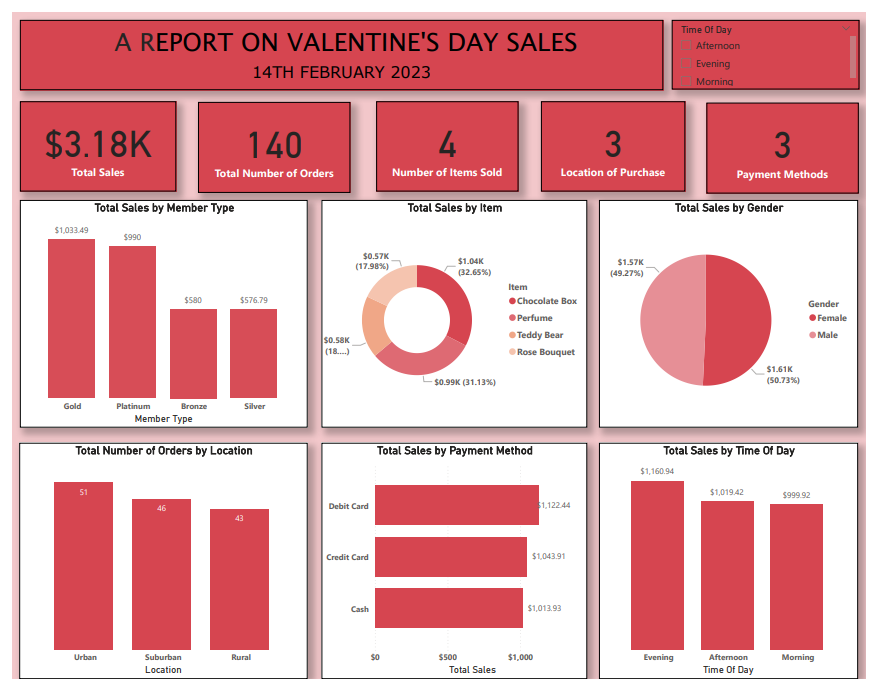
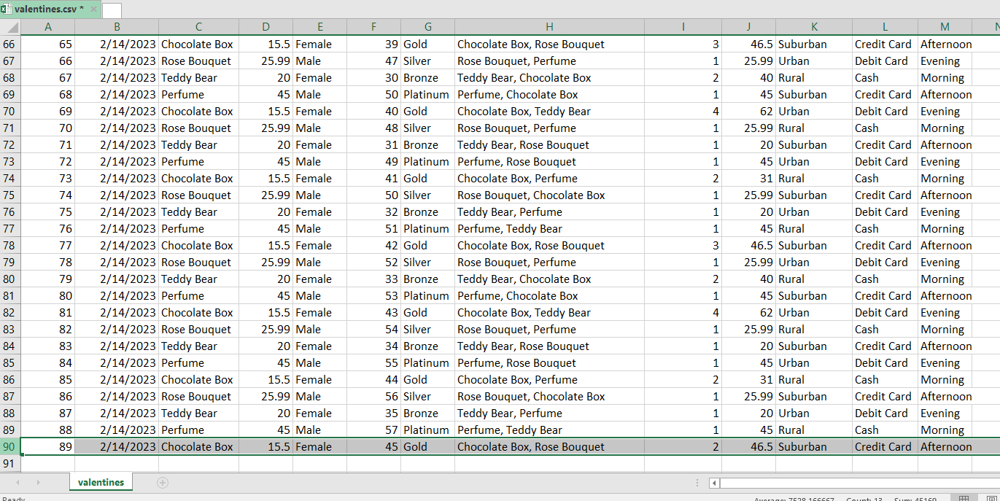

# Valentine's Day Sales Analysis

**Data cleaning, analysis and a Power BI dashboard on Valentine's Day 2023 transaction data.**



| | |
|---|---|
| **Tools** | Microsoft Excel, Power BI, Microsoft PowerPoint |
| **Data source** | Valentine's Day sales dataset from Kaggle |
| **Skills shown** | Data cleaning, imputation, outlier correction, KPI design, dashboarding, business storytelling |
| **Deliverables** | Cleaned dataset, Power BI dashboard, presentation deck ([`docs/THRIVE_PROJECT_1.pptx`](docs/THRIVE_PROJECT_1.pptx)) |

---

## Table of contents

1. [Business problem](#business-problem)
2. [Dataset](#dataset)
3. [Tools](#tools)
4. [Data cleaning](#data-cleaning)
5. [Dashboard](#dashboard)
6. [Key insights](#key-insights)
7. [Recommendations](#recommendations)
8. [Limitations](#limitations)
9. [Repository structure](#repository-structure)

---

## Business problem

The business had a solid Valentine's Day, but no clear view of *why*. Without that, it is hard to plan promotions, manage stock or refine its sales approach.

The analysis set out to answer:

- Which products performed best?
- Which payment methods do customers prefer?
- What influenced buying decisions and timing?
- How do customer segments differ in behaviour?

## Dataset

Transaction-level data from Kaggle covering Valentine's Day (14 February 2023). It includes:

- Items, prices and quantities
- Customer demographics (gender, age)
- Membership tier (Bronze, Silver, Gold, Platinum)
- Purchase location (Urban, Suburban, Rural)
- Payment method and time of day (Morning, Afternoon, Evening)

> Add the Kaggle link here, and place the raw CSV in [`data/`](data/) if the licence allows redistribution.

## Tools

| Tool | Used for |
|---|---|
| **Microsoft Excel** | Cleaning: removing errors, duplicates and incomplete records; sorting and categorising products; summarising payment methods; calculating revenue |
| **Power BI** | Interactive dashboard with KPI cards, charts and a time-of-day slicer |
| **Microsoft PowerPoint** | Presenting the findings to stakeholders |

## Data cleaning

A review of the sheet flagged three kinds of problem in **row 90**:

| Issue | Cell(s) | Fix |
|---|---|---|
| Outlier | `J90` held 89, far outside the range of the column | Recalculated revenue as price × quantity: `=D90*I90` |
| Missing values | `H90`, `I90` | `H90`: filled with "Chocolate Box, Rose Bouquet" after spotting the pattern in adjacent rows. `I90`: filled with the rounded-up average quantity: `=ROUNDUP(AVERAGE(I2:I89),0)` |
| Inconsistent data types | `K90`, `L90`, `M90` | Standardised to match each column's categories: "Suburban", "Credit Card", "Afternoon" |



## Dashboard

The Power BI report, *"A Report on Valentine's Day Sales"*, has:

- **KPI cards:** total sales, total orders, items sold, purchase locations, payment methods
- **Charts:** sales by member type, item, gender, payment method and time of day; orders by location
- **Slicer:** filter the whole report by time of day


## Key insights

**Overview:** $3.18K in total sales, 140 units sold, showing strong engagement over the Valentine's season.

**Products**

| Item | Sales | Share |
|---|---|---|
| Chocolate Box | $1.04K | 32.65% |
| Perfume | $0.99K | 31.13% |
| Teddy Bear | $0.58K | ~18% |
| Rose Bouquet | $0.57K | 17.98% |

Chocolate and perfume together make up roughly 64% of revenue.

**Customers**

- Gold ($1,033.49) and Platinum ($990.00) members generated the most sales; Bronze ($580.00) and Silver ($576.79) trailed well behind.
- Buying was split almost evenly by gender (Female 50.73%, Male 49.27%).

**Location:** Urban had the most orders (51), then Suburban (46) and Rural (43). The deck links the rural drop to accessibility.

**Payment method**

| Method | Sales |
|---|---|
| Debit card | $1,122.44 |
| Credit card | $1,043.91 |
| Cash | $1,013.93 |

Card payments lead, but the gap to cash is modest, so the preference for digital payment is a mild one.

**Time of day**

| Time | Sales |
|---|---|
| Evening | $1,160.94 |
| Afternoon | $1,019.42 |
| Morning | $999.92 |

Evening is the peak, which suggests customers shop after work.

## Recommendations

1. **Reward top tiers:** loyalty perks for Gold members, such as priority delivery or gifts.
2. **Focus stock and advertising** on perfume and chocolates in the Valentine's season.
3. **Grow rural sales** with delivery offers and targeted adverts.
4. **Run evening flash sales** to lean into the peak buying window.
5. **Encourage digital payments** with discounts, faster payment processing and contactless checkout.
6. **Introduce bundles** such as Teddy Bear + Chocolate and Rose + Chocolate combos.

## Limitations

- The data covers a single day, so it may not represent overall customer behaviour.
- External factors such as weather, promotions and competitors cannot be measured.
- The conclusions depend on the accuracy of the source data.

## Repository structure

```
valentines-day-sales-analysis/
├── README.md
├── data/                  # raw and cleaned datasets
├── powerbi/               # .pbix dashboard file
├── images/                # dashboard and cleaning screenshots
└── docs/
    └── THRIVE_PROJECT_1.pptx   # full presentation deck
```

## Author

**George** · Ghana
